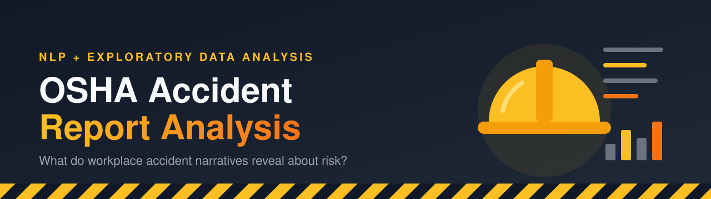
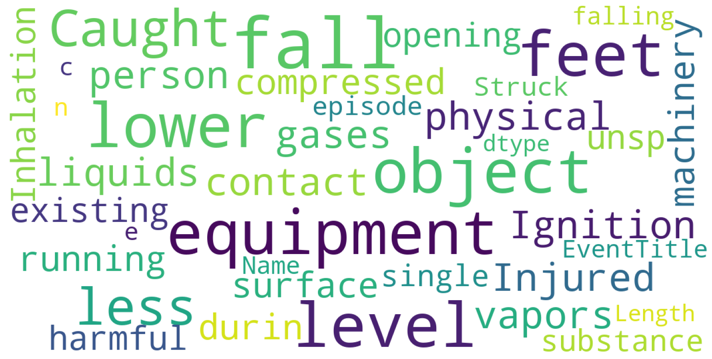

# Work Place Safety: NLP and EDA on OSHA Accident Reports



## Project Aim

Workplace accidents cost lives and money. This project uses real-world data from **OSHA** (the U.S. Occupational Safety and Health Administration) accident and injury reports to:

1. Explore what happens in workplace accidents (injury sources, affected body parts, day / month / hour patterns).
2. Apply NLP to the free-text accident descriptions and analyse which words dominate.
3. Train a classifier that predicts whether a report describes a **Fatal** or **Nonfatal** accident, to support risk assessment and proactive safety measures.

The write-up: [Harnessing Data and AI for Safer Workplaces (Medium)](https://medium.com/@hikmetemreguler/harnessing-data-and-ai-for-safer-workplaces-eda-and-nlp-insights-from-the-osha-work-accidents-af32eee626cd)

## Data

- **Source:** [OSHA Accident and Injury Data 2015-17 (Kaggle)](https://www.kaggle.com/datasets/ruqaiyaship/osha-accident-and-injury-data-1517), file `OSHA HSE DATA_ALL ABSTRACTS 15-17_FINAL.csv` (~35k reports, not included in this repo).
- **Modelling data (`model_df.csv`):** pre-processed, stemmed report text (`text`) and the target label (`level`: `Fatal` / `Nonfatal`).
- **App sample (`for_app.csv`):** `text`, `level`, `polarity` (sentiment polarity, -1 to +1) and `sentiment`.

## Steps

1. **Collect:** load the OSHA accident reports.
2. **EDA:** top injury sources, most affected body parts, accidents by weekday, month and hour.
3. **Text cleaning:** lowercase and stem the report text (e.g. `employe`, `amput`).
4. **NLP analysis:** word frequencies, word cloud, polarity / sentiment per report.
5. **Modelling:** bag-of-words (`CountVectorizer`) + `MultinomialNB` to classify Fatal vs Nonfatal. Saved as `cv1_model.pkl` and `mnb11_model.pkl`.
6. **Deploy:** a Streamlit app that classifies a pasted accident report.

## Output Gallery

Charts and screenshots from the [Medium write-up](https://medium.com/@hikmetemreguler/harnessing-data-and-ai-for-safer-workplaces-eda-and-nlp-insights-from-the-osha-work-accidents-af32eee626cd) (images are linked from Medium).

**Questions the analysis answers:** accident factors (human vs. environmental), primary and secondary sources of injury, most reported firms and states, hourly / monthly / daily accident patterns, injured body parts, distribution of hospitalized / amputated / no-damage cases, and the most frequent words, including those typical of fatal reports.



### 1. Accident factors (human vs. environmental)


### 2. Top sources of injury (1)


### 3. Top sources of injury (2)


### 4. Secondary sources of accidents (1)


### 5. Secondary sources of accidents (2)


### 6. Most reported firms


### 7. Most reported states


### 8. Accidents by hour of day


### 9. Accidents by month


### 10. Accidents by day of week


### 11. Injured body parts


### 12. Hospitalized / amputated / no-damage cases (1)


### 13. Hospitalized / amputated / no-damage cases (2)


### 14. Hospitalized / amputated / no-damage cases (3)


### 15. NLP word-frequency overview


### 16. Words associated with fatal accidents


### 17. Commonly occurring words in reports


### 18. Top words and frequencies (1)


### 19. Top words and frequencies (2)


### 20. Streamlit app screenshot


## Key Recommendations (from the article)

Enhance training and awareness, implement preventive measures, strengthen safety policies, foster a culture of reporting, and monitor continuously.

## Run the EDA / NLP Script

```bash
python eda_nlp.py --out-dir figures
```

Runs on `model_df.csv` (cleaned report text + label) and produces class balance, report length, top words, fatal-indicative words, word clouds, polarity, and the model evaluation. Needs `pandas`, `scikit-learn`, `matplotlib`, `joblib`; `wordcloud` and `textblob` are optional.

## Run the App

```bash
pip install -r requirements.txt
streamlit run app_workpl.py
```

Type a report description in the sidebar and press **Submit** to see the predicted damage level.

## Files

| File | Purpose |
|---|---|
| `app_workpl.py` | Streamlit app |
| `cv1_model.pkl`, `mnb11_model.pkl` | Trained vectorizer and classifier (need scikit-learn 1.2.2) |
| `model_df.csv`, `for_app.csv` | Modelling data and app sample |
| `requirements.txt` | Pinned dependencies |

## Author

Hikmet Emre Güler
